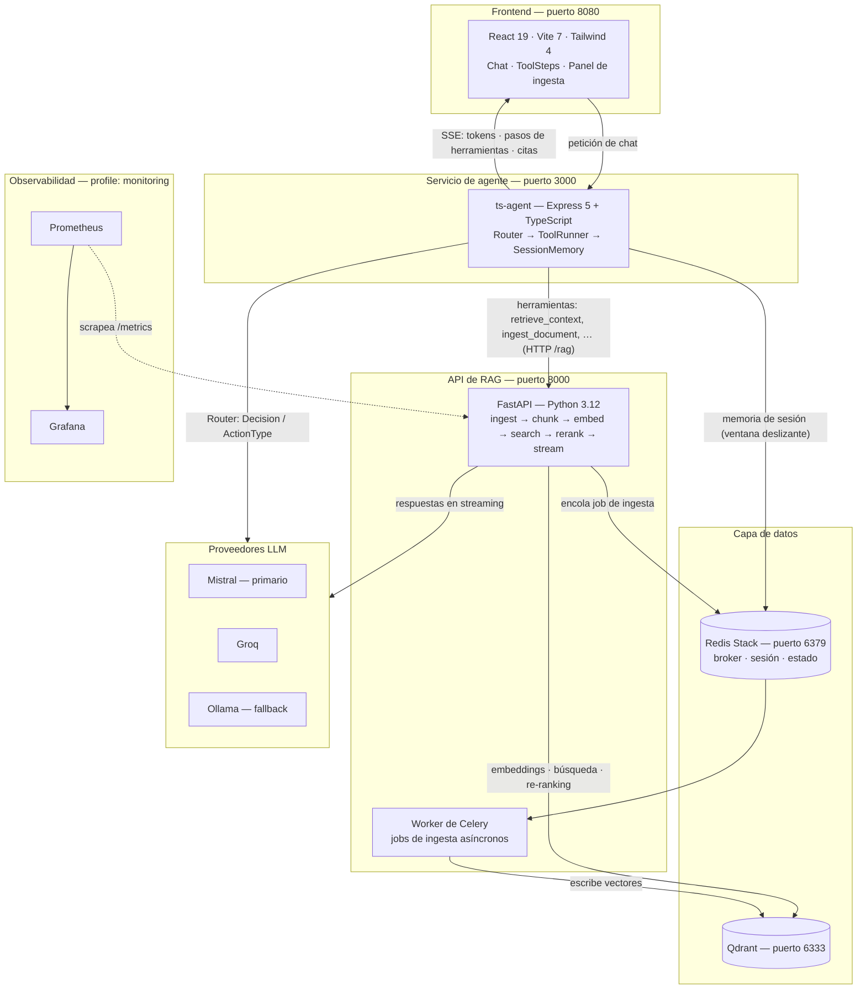

# AI Toolkit API

Backend experimental de RAG + Agent (v4.5) creado para demostrar criterio de arquitectura backend con LLMs.

[English](README.md) | **Español**

## Descripción y funcionalidades principales

> **Propósito del proyecto** — Es un proyecto de laboratorio/portafolio, no un producto terminado. Muestra cómo estructuro un backend alrededor de LLMs: capas desacopladas, proveedores intercambiables, enrutamiento determinista del agente y observabilidad desde el primer día.

AI Toolkit API es una stack educativa/experimental que ingiere documentos (URL o PDF), los fragmenta, los embebe en un vector store y responde preguntas a través de un agente de chat capaz de invocar herramientas — con respuestas en streaming y citas.

- **Pipeline de RAG** — ingesta (URL/PDF) → chunking (Strategy Pattern) → embeddings → Qdrant → re-ranking → respuestas en streaming con citas.
- **Ciclo del agente** — `Router` (el LLM decide la próxima acción) → `ToolRunner` (ejecuta las herramientas) → `SessionMemory` (ventana deslizante), con un enum tipado `Decision` / `ActionType`: `RETRIEVE_CONTEXT`, `CALL_TOOL`, `ASK_USER`, `FINAL_ANSWER`.
- **LLM multi-proveedor con fallback + circuit breaker** — Mistral (primario), Groq, Ollama (fallback); las capacidades de proveedores y modelos se cargan desde `providers.yaml`.
- **Ingesta con human-in-the-loop** — cuando un documento nuevo llega sin metadatos, el agente los pide en el chat antes de ingerirlo.
- **Jobs de ingesta asíncronos** — worker de Celery respaldado por Redis, para que una ingesta pesada nunca bloquee la API.
- **Streaming por SSE** — tokens, pasos de herramientas y citas fluyen hacia el frontend; `ToolSteps` muestra el razonamiento del agente de forma colapsable.
- **Observabilidad** — endpoint `/metrics` de Prometheus con histogramos de latencia/tokens/errores/fallbacks, métricas de tareas de Celery y logs estructurados con `structlog` e IDs de request/sesión.
- **Desacoplado por diseño** — API, lógica de negocio y proveedores LLM son independientes e intercambiables.

## Arquitectura



## Tecnologías utilizadas

| Grupo | Stack |
| --- | --- |
| **Backend** | Python 3.12+, FastAPI, Uvicorn, Pydantic Settings, Celery, structlog, cliente Qdrant, LlamaIndex, sentence-transformers, pdfplumber, BeautifulSoup4, prometheus-client, PyYAML |
| **Agente** | Node.js, Express 5, TypeScript, Zod (validación de entradas), ioredis (memoria de sesión), streaming SSE, configuración vía `providers.yaml`, Vitest |
| **Frontend** | React 19, Vite 7, Tailwind CSS 4, Radix UI, react-markdown + remark-gfm (tablas), lucide-react, pnpm |
| **Infraestructura** | Docker Compose, Redis Stack (broker + estado), Qdrant (vectores), nginx (servido del frontend), Ollama (LLM local opcional, profile ROCm) |
| **Observabilidad** | Prometheus, Grafana, celery-exporter, logs estructurados con `structlog`, middleware de IDs de request/sesión |

## Instalación y ejecución

### Requisitos previos

- Docker + Docker Compose
- Para desarrollo local: Python 3.12+, pnpm, Node.js 20+

### 1. Clonar

```bash
git clone https://github.com/SrStamm/ai-toolkit-api.git
cd ai-toolkit-api
```

### 2. Configurar el entorno

Copiá y completá tus claves (ver [Variables de entorno](#variables-de-entorno)):

```bash
# API (raíz del repo)
cp .env.example .env      # o creá .env manualmente

# Agente
cp ts-agent/.env.example ts-agent/.env   # o crealo manualmente
```

Como mínimo necesitás `MISTRAL_API_KEY` (o `GROQ_API_KEY`) para los proveedores LLM alojados.

### 3. Ejecutar con Docker Compose (principal)

```bash
docker compose up --build
```

| Servicio | URL |
| --- | --- |
| Frontend | http://localhost:8080 |
| API (FastAPI, docs en `/docs`) | http://localhost:8000 |
| ts-agent | http://localhost:3000 |
| Qdrant | http://localhost:6333 |

Profiles opcionales:

```bash
# Prometheus + Grafana + celery-exporter
docker compose --profile monitoring up

# LLM local vía Ollama (ROCm)
docker compose --profile ollama up
```

> ⚠️ Grafana y ts-agent usan ambos el puerto de host `3000`. Detené el agente (o remapeá el puerto) antes de habilitar el profile `monitoring`.

### 4. Ejecutar servicios en local (secundario)

Levantá primero solo la capa de datos:

```bash
docker compose up -d redis qdrant celery
```

Y luego, en terminales separadas:

```bash
# Backend — http://localhost:8000
uvicorn app.main:app --reload

# Agente — http://localhost:3000
cd ts-agent && pnpm install && pnpm dev

# Frontend — http://localhost:5173
cd front-ai-toolkit && pnpm install && pnpm dev
```

### Scripts de apoyo

| Script | Propósito |
| --- | --- |
| `scripts/ask.py`, `scripts/ask.sh` | Consultar la API desde la terminal |
| `scripts/ingest.py`, `scripts/ingest.sh` | Ingerir un documento desde la terminal |
| `scripts/start_dev_monitoring.sh` | Levantar el stack de desarrollo con monitoreo |
| `scripts/start_prod.sh` | Levantar el stack de producción |

## Variables de entorno

### API — `./.env` (cargada por `app/core/settings.py`)

| Variable | Descripción | Requerida | Por defecto |
| --- | --- | --- | --- |
| `P_PROVIDER` | Proveedor LLM primario | No | `mistral` |
| `P_API_KEY` | API key del proveedor primario | Sí\* | *(vacía)* |
| `P_MODEL` | Modelo primario | No | `mistral-small-latest` |
| `P_URL` | Override de URL base del proveedor primario | No | *(por defecto del proveedor)* |
| `F_PROVIDER` | Proveedor LLM de fallback | No | `ollama` |
| `F_API_KEY` | API key del proveedor de fallback | No\* | *(vacía)* |
| `F_MODEL` | Modelo de fallback | No | `qwen2.5:7b` |
| `F_URL` | URL base del proveedor de fallback | No | `http://host.docker.internal:11434` |
| `REDIS_URL` | URL completa de Redis; si se define, reemplaza host/puerto/db | No | *(vacía)* |
| `REDIS_HOST` | Host de Redis | No | `localhost` |
| `REDIS_PORT` | Puerto de Redis | No | `6379` |
| `REDIS_DB` | Índice de base de Redis | No | `0` |
| `QDRANT_HOST` | Host de Qdrant | No | `qdrant` |
| `QDRANT_PORT` | Puerto de Qdrant | No | `6333` |
| `ALLOWED_ORIGINS` | Orígenes CORS separados por coma | No | `http://localhost:8000,http://localhost:8080,http://localhost:5173` |
| `ENVIRONMENT` | Entorno de ejecución | No | `development` |
| `DEBUG` | Flag de debug | No | `false` |
| `MISTRAL_API_KEY` | Resuelta vía `api_key_env` en `providers.yaml` | Cuando el proveedor es `mistral` | *(vacía)* |
| `GROQ_API_KEY` | Resuelta vía `api_key_env` en `providers.yaml` | Cuando el proveedor es `groq` | *(vacía)* |

\* Requerida para proveedores alojados (Mistral, Groq); no hace falta con Ollama local.

### ts-agent — `ts-agent/.env`

| Variable | Descripción | Requerida | Por defecto |
| --- | --- | --- | --- |
| `RAG_URL` | URL base de los endpoints de RAG de FastAPI | No | `http://api:8000/rag` (Docker) / `http://localhost:8000/rag` (fallback en el código) |
| `REDIS_URL` | String de conexión a Redis usado por `SessionMemory` | No | `redis://localhost:6379` |
| `REDIS_HOST` | Host de Redis (alternativa a `REDIS_URL`) | No | `localhost` |
| `MISTRAL_API_KEY` / `GROQ_API_KEY` | Claves de proveedor resueltas desde `api_key_env` en `providers.yaml` | Cuando se selecciona un proveedor alojado | *(vacía)* |

## Tests

| Suite | Comando | Cobertura |
| --- | --- | --- |
| Backend | `pytest` (o `python -m pytest`) desde la raíz del repo | `test_structured_output.py`, `test_exceptions.py`, `test_circuit_breaker.py` (`pytest.ini` → `testpaths = tests`) |
| ts-agent | `pnpm test` dentro de `ts-agent/` | Suites de Vitest (`vitest run`) |
| Frontend | `pnpm build` dentro de `front-ai-toolkit/` | Type-check (`tsc -b`) + build de producción |
| Lint de frontend | `pnpm lint` dentro de `front-ai-toolkit/` | ESLint |

## Capturas / GIF

> 📸 *Dejá tus capturas o un GIF demo en `docs/screenshots/` y referencialos acá.*

```html
<!-- Ejemplo:


-->
```

## Limitaciones conocidas

- **Educacional/experimental** — no está endurecido para producción; esperá bordes ásperos.
- **Sin autenticación/autorización** en los endpoints de la API, y el frontend tampoco la tiene.
- **Celery single-node** — no se incluye configuración de escalado horizontal.
- **Los modelos de Ollama no soportan tool calling** — `supports_tools: false` en `providers.yaml`, por lo que la ruta de fallback no puede ejecutar el loop completo de herramientas.
- **Sin pipeline de CI/CD** configurado en el repositorio.
- **Sin base de datos relacional** — el estado de la aplicación vive solo en Redis y Qdrant (no hay Postgres).