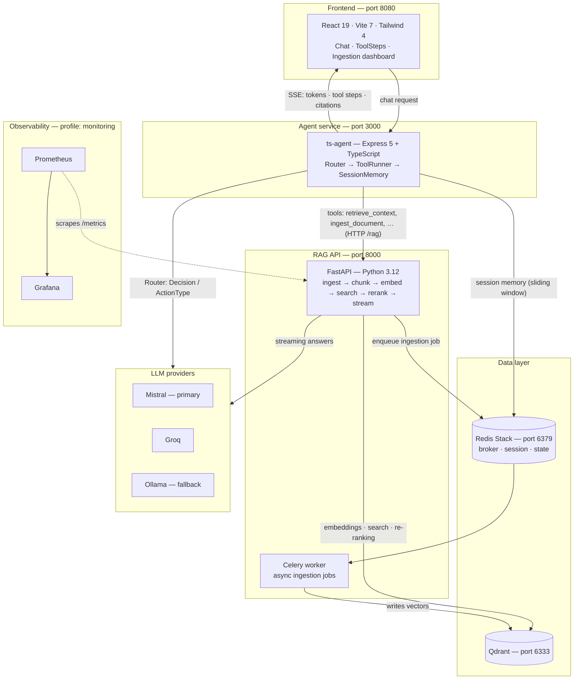

# AI Toolkit API

Experimental RAG + Agent backend (v4.5) built to show backend architecture judgment with LLMs.

**English** | [Español](README.es.md)

## Description & main features

> **Project purpose** — This is a lab/portfolio project, not a finished product. It demonstrates how I structure a backend around LLMs: decoupled layers, swappable providers, deterministic agent routing, and observability from day one.

AI Toolkit API is an educational/experimental stack that ingests documents (URL or PDF), chunks them, embeds them into a vector store, and answers questions through a chat agent that can call tools — with streaming responses and citations.

- **RAG pipeline** — ingestion (URL/PDF) → chunking (Strategy Pattern) → embeddings → Qdrant → re-ranking → streaming answers with citations.
- **Agent loop** — `Router` (LLM decides the next action) → `ToolRunner` (executes tools) → `SessionMemory` (sliding window), with a typed `Decision` / `ActionType` enum: `RETRIEVE_CONTEXT`, `CALL_TOOL`, `ASK_USER`, `FINAL_ANSWER`.
- **Multi-provider LLM with fallback + circuit breaker** — Mistral (primary), Groq, Ollama (fallback); provider/model capabilities loaded from `providers.yaml`.
- **Human-in-the-loop ingestion** — when a new document arrives without metadata, the agent asks for it in chat before ingesting.
- **Async ingestion jobs** — Celery worker backed by Redis, so heavy ingestion never blocks the API.
- **SSE streaming** — tokens, tool steps, and citations stream to the frontend; `ToolSteps` renders the agent's reasoning as a collapsible trail.
- **Observability** — `/metrics` Prometheus endpoint with latency/token/error/fallback histograms, Celery task metrics, and `structlog` structured logging with request/session IDs.
- **Decoupled by design** — API, business logic, and LLM providers are independent and swappable.

## Architecture



## Technologies used

| Group | Stack |
| --- | --- |
| **Backend** | Python 3.12+, FastAPI, Uvicorn, Pydantic Settings, Celery, structlog, Qdrant client, LlamaIndex, sentence-transformers, pdfplumber, BeautifulSoup4, prometheus-client, PyYAML |
| **Agent** | Node.js, Express 5, TypeScript, Zod (input validation), ioredis (session memory), SSE streaming, `providers.yaml` configuration, Vitest |
| **Frontend** | React 19, Vite 7, Tailwind CSS 4, Radix UI, react-markdown + remark-gfm (tables), lucide-react, pnpm |
| **Infrastructure** | Docker Compose, Redis Stack (broker + state), Qdrant (vectors), nginx (frontend serving), Ollama (optional local LLM, ROCm profile) |
| **Observability** | Prometheus, Grafana, celery-exporter, `structlog` structured logs, request/session ID middleware |

## Installation & running

### Prerequisites

- Docker + Docker Compose
- For local development: Python 3.12+, pnpm, Node.js 20+

### 1. Clone

```bash
git clone https://github.com/SrStamm/ai-toolkit-api.git
cd ai-toolkit-api
```

### 2. Configure environment

Copy and fill in your keys (see [Environment variables](#environment-variables)):

```bash
# API (root)
cp .env.example .env      # or create .env manually

# Agent
cp ts-agent/.env.example ts-agent/.env   # or create it manually
```

At minimum you need `MISTRAL_API_KEY` (or `GROQ_API_KEY`) for hosted LLM providers.

### 3. Run with Docker Compose (primary)

```bash
docker compose up --build
```

| Service | URL |
| --- | --- |
| Frontend | http://localhost:8080 |
| API (FastAPI, docs at `/docs`) | http://localhost:8000 |
| ts-agent | http://localhost:3000 |
| Qdrant | http://localhost:6333 |

Optional profiles:

```bash
# Prometheus + Grafana + celery-exporter
docker compose --profile monitoring up

# Local LLM via Ollama (ROCm)
docker compose --profile ollama up
```

> ⚠️ Grafana and ts-agent both bind host port `3000`. Stop the agent (or remap the port) before enabling the `monitoring` profile.

### 4. Run services locally (secondary)

Bring up only the data layer first:

```bash
docker compose up -d redis qdrant celery
```

Then, in separate terminals:

```bash
# Backend — http://localhost:8000
uvicorn app.main:app --reload

# Agent — http://localhost:3000
cd ts-agent && pnpm install && pnpm dev

# Frontend — http://localhost:5173
cd front-ai-toolkit && pnpm install && pnpm dev
```

### Helper scripts

| Script | Purpose |
| --- | --- |
| `scripts/ask.py`, `scripts/ask.sh` | Ask the API from the CLI |
| `scripts/ingest.py`, `scripts/ingest.sh` | Ingest a document from the CLI |
| `scripts/start_dev_monitoring.sh` | Start dev stack with monitoring |
| `scripts/start_prod.sh` | Start the production stack |

## Environment variables

### API — `./.env` (loaded by `app/core/settings.py`)

| Variable | Description | Required | Default |
| --- | --- | --- | --- |
| `P_PROVIDER` | Primary LLM provider | No | `mistral` |
| `P_API_KEY` | API key for the primary provider | Yes\* | *(empty)* |
| `P_MODEL` | Primary model | No | `mistral-small-latest` |
| `P_URL` | Base URL override for the primary provider | No | *(provider default)* |
| `F_PROVIDER` | Fallback LLM provider | No | `ollama` |
| `F_API_KEY` | API key for the fallback provider | No\* | *(empty)* |
| `F_MODEL` | Fallback model | No | `qwen2.5:7b` |
| `F_URL` | Fallback provider base URL | No | `http://host.docker.internal:11434` |
| `REDIS_URL` | Full Redis URL; when set, overrides host/port/db | No | *(empty)* |
| `REDIS_HOST` | Redis host | No | `localhost` |
| `REDIS_PORT` | Redis port | No | `6379` |
| `REDIS_DB` | Redis database index | No | `0` |
| `QDRANT_HOST` | Qdrant host | No | `qdrant` |
| `QDRANT_PORT` | Qdrant port | No | `6333` |
| `ALLOWED_ORIGINS` | Comma-separated CORS origins | No | `http://localhost:8000,http://localhost:8080,http://localhost:5173` |
| `ENVIRONMENT` | Runtime environment | No | `development` |
| `DEBUG` | Debug flag | No | `false` |
| `MISTRAL_API_KEY` | Resolved via `api_key_env` in `providers.yaml` | When provider = `mistral` | *(empty)* |
| `GROQ_API_KEY` | Resolved via `api_key_env` in `providers.yaml` | When provider = `groq` | *(empty)* |

\* Required for hosted providers (Mistral, Groq); not needed for local Ollama.

### ts-agent — `ts-agent/.env`

| Variable | Description | Required | Default |
| --- | --- | --- | --- |
| `RAG_URL` | Base URL of the FastAPI RAG endpoints | No | `http://api:8000/rag` (Docker) / `http://localhost:8000/rag` (code fallback) |
| `REDIS_URL` | Redis connection string used by `SessionMemory` | No | `redis://localhost:6379` |
| `REDIS_HOST` | Redis host (alternative to `REDIS_URL`) | No | `localhost` |
| `MISTRAL_API_KEY` / `GROQ_API_KEY` | Provider keys resolved from `providers.yaml` `api_key_env` | When a hosted provider is selected | *(empty)* |

## Tests

| Suite | Command | Covers |
| --- | --- | --- |
| Backend | `pytest` (or `python -m pytest`) from the repo root | `test_structured_output.py`, `test_exceptions.py`, `test_circuit_breaker.py` (`pytest.ini` → `testpaths = tests`) |
| ts-agent | `pnpm test` in `ts-agent/` | Vitest suites (`vitest run`) |
| Frontend | `pnpm build` in `front-ai-toolkit/` | Type-check (`tsc -b`) + production build |
| Frontend lint | `pnpm lint` in `front-ai-toolkit/` | ESLint |

## Screenshots / GIF

> 📸 *Drop your screenshots or a demo GIF in `docs/screenshots/` and reference them here.*

```html
<!-- Example:


-->
```

## Known limitations

- **Educational/experimental** — not production-hardened; expect rough edges.
- **No authentication/authorization** on API endpoints, and the frontend has none either.
- **Single-node Celery** — no horizontal-scaling configuration is shipped.
- **Ollama models lack tool calling** — `supports_tools: false` in `providers.yaml`, so the fallback path cannot drive the full tool loop.
- **No CI/CD pipeline** configured in the repository.
- **No relational database** — application state lives only in Redis and Qdrant (no Postgres).
